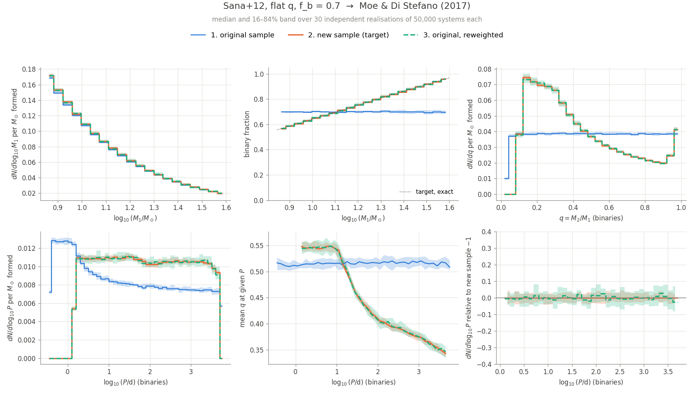
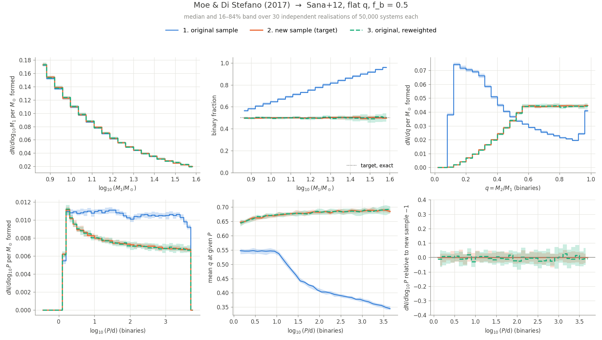
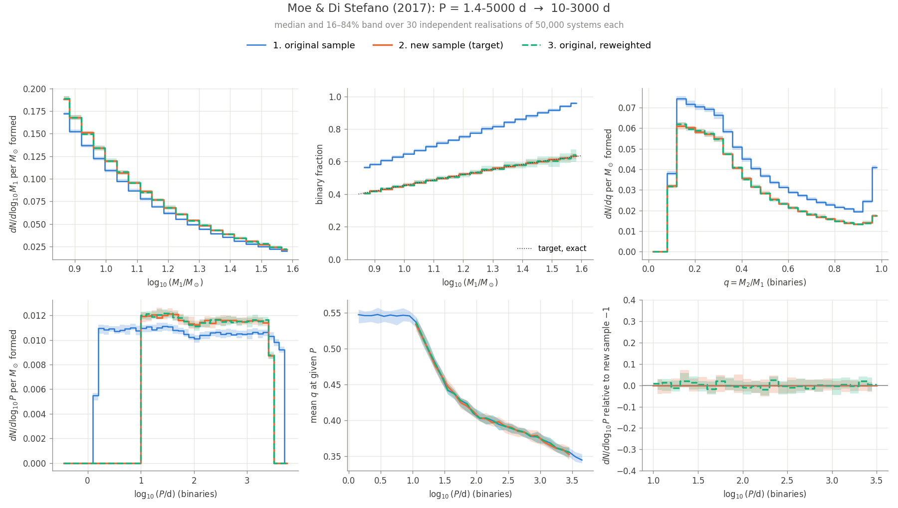

# Reweighting to and from the Moe & Di Stefano (2017) distributions

This note shows that `norm_pop.calculate_model_weights` gets the
Moe & Di Stefano (2017) distributions (`Moe+17-PsandQs`) right. It covers
reweighting a simulation to Moe, from Moe, and between two Moe set-ups.

## What changed

This builds on #962, where the sampler (`independent_sample`) and the
reweighting (`norm_pop`) get their distributions from the same functions in
`initial_distributions`. Moe & Di Stefano (2017) is now one more case of those
functions. Whenever `use_Moe_17_PsandQs` is true, each one returns a thin
wrapper in `distributions.py` around a shared, cached `Moe_17_PsandQs`:

| function | Moe wrapper | what it gives |
|---|---|---|
| `get_binary_fraction_distribution` | `Moe17BinaryFraction` | f_b(M1); `binary_fraction_*` is ignored, as in the sampler |
| `get_mass_ratio_distribution` | `Moe17MassRatio` | p(q \| M1, P), normalised to 1 |
| `get_orbital_distribution` | `Moe17Period` | `pdf_per_dex`: p(log10 P \| M1, binary) = `logP_pdf / binary_fraction`, normalised to 1; `pdf`: the same per unit P |

The changes this needed:

1. **Shared interfaces.** Every binary-fraction distribution now has
   `binary_fraction(m1)` and `pdf(binary, m1)`; `ConstantBinaryFraction`
   ignores m1. Every mass-ratio `pdf(q, m1, p)` accepts the period, unused
   except by Moe. This mirrors how the period distributions already accept an
   unused q. `MassRatioDistribution.depends_on_period` marks Moe.
2. **`get_pdf` keeps the product form.** It is
   f_b(m1)·IMF(m1)·p(q | m1, P)·p(log10 P | m1, q), with period densities per
   dex for every scheme. For Moe, f_b·`Moe17MassRatio`·`Moe17Period` equals
   `Moe_17_PsandQs.pdf`, so the binary fraction is counted once.
   `mass_pdf=True` raises for Moe, because its q marginal depends on P.
3. **The mean mass is a single integral over M1:**
   `mean_mass = ∫ IMF(m1) m1 [1 + f_b(m1) E[q | m1]] dm1`. E[q | m1] is the new
   `MassRatioDistribution.mean(m1)`. The base class integrates it numerically
   over `support(m1)`, and the flat distributions use the analytic centre of
   their bounds. `Moe17MassRatio` uses the closed-form
   `Moe_17_PsandQs.mean_q`, which is exact in q and averaged over the period
   distribution. A numerical double integral of `pdf` instead takes 20–400×
   longer and is less accurate (relative error 1e-3 to 3e-4). The kinks of
   f_b(M1) are passed to `quad` as break points.
4. **The binary-fraction check is done per M1.**
   `check_binary_fraction_coverage` replaces the `f_b` guards. It compares
   the simulation and target binary fractions on a grid of primary masses
   where the two mass ranges overlap:
   - If the target wants only binaries where the simulation has none (or only
     single stars where the simulation has none), it raises a `ValueError`.
     The messages are the same as before.
   - If the target wants a kind of system the simulation lacks, but the other
     kind is covered, it only warns. That kind is then missing from the
     weights. Examples are a binary-only simulation reweighted to Moe, or a
     Moe simulation, which has no binaries at M1 ≤ 0.08 Msun.
5. **The Moe check and cache moved.** `use_Moe_17_PsandQs` and the generator
   cache moved from `independent_sample` to `initial_distributions`, so the
   sampler and the reweighting build the same `Moe_17_PsandQs`.

## Set-up of the figures

In each case:

1. **Original sample.** A population is drawn with the simulation settings.
2. **New sample.** A population is drawn directly with the target settings.
3. **Original, reweighted.** The original sample is weighted to the target
   with `calculate_model_weights`.

All distributions are per M☉ formed: counts divided by the sampled mass for
1 and 2, and summed weights for 3. A wrong mean-mass normalisation would
therefore show up as an offset.

**Uncertainty from resampling:** both populations are drawn 30 times with
independent seeds, at 50,000 systems each. The weights are recomputed for each
realisation. Lines are the median over the realisations, and bands are the
16–84 % range.

Every case has a Kroupa (2001) IMF and M1 = 7–40 M☉. Each target lies inside
the support of its simulation, in M1, q and P.

Panels: the primary-mass distribution of all systems; the binary fraction as a
function of M1 (dotted line: the exact target f_b(M1)); the q and log10 P
distributions of binaries; the mean q at a given P, which tests the joint
(q, P) term; and the log10 P distribution relative to the new sample.

Reproduce with (about 1 min):

```bash
python dev-tools/moe_reweighting/make_figures.py
```

## 1. Sana+12, flat q, f_b = 0.7 → Moe (P = 1.4–5000 d)

The common use: an existing POSYDON run, reweighted to Moe.



## 2. Moe → Sana+12, flat q, f_b = 0.5

The target has `secondary_mass_min = 4` M☉, which keeps q ≥ 0.1 inside the Moe
support.



## 3. Moe, P = 1.4–5000 d → Moe, P = 10–3000 d

A narrower period range lowers f_b(M1) and changes the mean q, because q
depends on P.



## Summary

Median ± half the 16–84 % range over the 30 realisations.

**Sana+12, flat q, f_b = 0.7 → Moe & Di Stefano (2017)**

| | systems per Msun (×10⁻²) | binary fraction | mean log₁₀ P (binaries) | mean q (binaries) |
|---|---|---|---|---|
| 1. original sample | 5.338 ± 0.014 | 0.701 ± 0.002 | 1.442 ± 0.006 | 0.515 ± 0.001 |
| 2. new sample (target) | 5.444 ± 0.018 | 0.692 ± 0.002 | 1.900 ± 0.006 | 0.444 ± 0.001 |
| 3. original, reweighted | 5.439 ± 0.021 | 0.693 ± 0.002 | 1.902 ± 0.009 | 0.444 ± 0.002 |

**Moe & Di Stefano (2017) → Sana+12, flat q, f_b = 0.5**

| | systems per Msun (×10⁻²) | binary fraction | mean log₁₀ P (binaries) | mean q (binaries) |
|---|---|---|---|---|
| 1. original sample | 5.441 ± 0.016 | 0.692 ± 0.002 | 1.900 ± 0.004 | 0.443 ± 0.001 |
| 2. new sample (target) | 5.487 ± 0.014 | 0.500 ± 0.002 | 1.796 ± 0.007 | 0.677 ± 0.001 |
| 3. original, reweighted | 5.485 ± 0.025 | 0.500 ± 0.004 | 1.796 ± 0.011 | 0.677 ± 0.001 |

**Moe & Di Stefano (2017): P = 1.4–5000 d → 10–3000 d**

| | systems per Msun (×10⁻²) | binary fraction | mean log₁₀ P (binaries) | mean q (binaries) |
|---|---|---|---|---|
| 1. original sample | 5.441 ± 0.016 | 0.692 ± 0.002 | 1.900 ± 0.004 | 0.443 ± 0.001 |
| 2. new sample (target) | 5.976 ± 0.017 | 0.483 ± 0.001 | 2.227 ± 0.003 | 0.415 ± 0.001 |
| 3. original, reweighted | 5.980 ± 0.027 | 0.483 ± 0.003 | 2.228 ± 0.004 | 0.415 ± 0.001 |

In all three cases the reweighted sample agrees with the new sample within the
resampling uncertainty, in every distribution and in the number of systems per
M☉. The bands of the reweighted sample are about 1.5× wider than those of the
new sample, because unequal weights reduce the effective sample size. This is
largest where the target puts more systems than the simulation, such as long
periods in case 1.

## Caveat found on the way (not changed here)

For `flat_mass_ratio`, the sampler ignores `q_min`/`q_max` and draws q from
`secondary_mass_min/max`. `norm_pop` uses `q_min`/`q_max` when they are given.
A population whose settings contain `q_min`/`q_max` is therefore not described
by its own PDF, and the weights it gets are wrong.
This is unchanged by #962: `generate_secondary_masses` still builds its
distribution only from `secondary_mass_min/max`.
